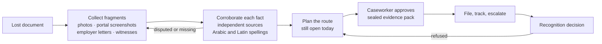

# IsnadProof-AI-Agent
An AI agent that helps displaced people rebuild proof of lost degrees, marriage contracts and birth certificates, then gets that proof recognised.

# IsnadProof · إسناد

**An AI agent that helps people rebuild proof of the documents they lost, so they can be recognised, hired and reunited.**

*Isnad* (إسناد) is the classical Arabic method of proving a report true through a documented chain of reliable, independent transmitters. *IsnadProof* applies that discipline to lost documents: each fact is proved by a chain of independent sources. When a war, a flight or a disaster destroys a person's degree, marriage contract or birth certificate, the usual recognition chain breaks: there is no original to attest, and sometimes no office left to ask. IsnadProof collects the fragments the person still has, corroborates them across independent sources, finds the recognition route that is still open, and follows it through to a decision.

> **Status: working prototype.** The full dossier workflow runs end to end with 19 passing tests. It uses fictional demo data (including a fictional country, "XC") and, by default, an offline rule-based model stand-in so anyone can run it without a GPU. The connection to UAE open-weight models (Falcon-H1 Arabic, Jais 2) is implemented behind a switch. Pilot figures in this README are **targets to test, not results**.

---

## The problem

In the UAE, foreign documents are recognised through a chain. The issuing country attests them, then the UAE embassy there, then the UAE Ministry of Foreign Affairs (MoFAIC). Degrees may also need recognition (equivalency) from the Ministry of Higher Education and Scientific Research (MoHESR). Family sponsorship needs attested marriage and birth certificates. The chain assumes three things:

1. you still have the original;
2. the issuing institution can still confirm it;
3. the offices along the route are open to you.

For people displaced by conflict, often none of these hold. At the end of 2025, **117.8 million people were forcibly displaced worldwide** (UNHCR Global Trends 2026). An engineer with a job offer in Dubai, a mother sponsoring her children, a doctor wanting to practise: each can be stopped by one missing paper.

## What IsnadProof does



| Today | With IsnadProof |
| --- | --- |
| "Bring the attested original." The case stops there. | The agent asks for the fragments that can prove each fact, in Arabic, over WhatsApp |
| Fragments are judged inconsistently, or not at all | A transparent, weighted vote per fact; contradictions are shown, never hidden |
| People try routes that cannot work for them | Routes are checked against what the person has and which authorities are open, with fallbacks |
| Authorities cannot tell what changed after submission | A sealed evidence pack and a hash-chained log |
| Nobody follows up | Deadlines, reminders, escalation, and the next route if refused |
| Policy-makers can't see where recognition fails | Insight on which authorities and requirements block people most |

**What is new:** see [docs/prior-art.md](docs/prior-art.md). In short, document-processing products read documents organisations already hold. Attestation agencies need the original. The UNESCO / Dubai Cares Qualifications Passport assesses qualifications without full documents but relies on human assessors and covers only qualifications. IsnadProof rebuilds and corroborates the evidence, plans the route and follows it through. It complements those schemes rather than competing with them.

---

## See it work

```bash
git clone <this-repo-url> isnadproof && cd isnadproof
python -m venv .venv && source .venv/bin/activate     # Windows: .venv\Scripts\activate
pip install -r requirements.txt
python manage.py migrate
python manage.py run_demo        # add --pause 1 when presenting
```

Real output, abridged. Everything is fictional; messages to the person are in Arabic.

```text
▶ 1. Rana writes on WhatsApp in Arabic and agrees to how her data is used
  "أنا مهندسة مدنية وحصلت على عرض عمل في دبي، لكن شهادتي الجامعية فُقدت أثناء الحرب ولا أستطيع تصديقها."
  (I'm a civil engineer with a job offer in Dubai, but my university degree was lost in the war and I can't attest it.)
  [agent:intake        ] understood     Engineer with a UAE job offer needs the degree recognised; original documents lost.
  [agent:requirements  ] requirements   University degree must prove: full_name, degree, institution, graduation_year

▶ 2. She sends the fragments she still has
  [agent:collector     ] evidence_in    Photo or scan of the original document: Phone photo of the degree certificate (2016)
  [agent:collector     ] evidence_in    Letter from an employer: Letter from former employer, Nahar Contracting
  [agent:collector     ] evidence_in    Signed witness statement: Signed statement from a classmate (Arabic)
  [agent:collector     ] integrity_flag Set aside 'Certificate PDF downloaded from a website': file metadata shows editing software

▶ 3. Corroboration: are the facts established by independent evidence?
  [agent:corroboration ] assessment     full_name=Rana Al-Haddad (established, 100%, 3 src), degree=BSc Civil Engineering (established),
                                        institution=University of Al-Nahar (established), graduation_year=2016 (disputed, 70%)
  [agent:communication ] message_out    تختلف مستنداتك في سنة التخرج (2016 / 2015). هل لديك سجل من الجهة المصدرة، مثل كشف درجات أو صورة من بوابة الطلاب؟

▶ 4. She finds a screenshot of the old student portal
  [agent:corroboration ] assessment     … graduation_year=2016 (established, 79%, 3 src)
  [agent:corroboration ] note           graduation_year: minor disagreement recorded (2015 from employer:nahar-contracting)
  [agent:planner       ] route_skipped  Standard attestation chain: needs the original document, which the person no longer has; …
  [agent:planner       ] route_skipped  Re-issued certificate legalised through Country X's embassy in the UAE: university not reissuing
  [agent:planner       ] route_chosen   Qualifications Passport assessment from the evidence dossier
  [agent:communication ] message_out    الطريق المقترح: تقييم «جواز المؤهلات» استناداً إلى ملف الأدلة. مهم: هذا تقييم وليس شهادة رسمية…

▶ 5. A caseworker reviews and approves; the evidence pack is sealed and submitted
  [caseworker          ] transition     Caseworker review → Submitted: evidence pack sealed sha256:5a8765b4f461bb72…

▶ 6. Step 1 completes; step 2 stalls → reminder, then escalation
  [agent:tracker       ] reminder       Reminder sent to the authority for Structured interview with a credential evaluator
  [agent:tracker       ] escalation     Level 1: follow-up letter drafted … and caseworker alerted

▶ 7. The interview happens, the decision is issued, the outcome is recorded
  [caseworker          ] transition     Submitted → Recognised: Qualifications Passport issued for BSc Civil Engineering (University of Al-Nahar, 2016).

▶ 8. Integrity: verify the tamper-evident log, then try to tamper with it
  Log of 56 events verified: intact
  After editing event 5 directly in the database: chain broken at event 5

▶ 9. Insight for decision-makers
  2 standard routes were blocked across 1 dossier. Most common block: University of Al-Nahar (fictional) (2 times).
```

Then open the caseworker console:

```bash
python manage.py runserver        # http://127.0.0.1:8000/admin — caseworker / demo-pass-123
python manage.py test tests       # 19 tests
python manage.py export_dossier <reference> --out pack.json   # sealed evidence pack
```

---

## How IsnadProof differs from similar names and products

Several projects already use the word *Isnad*, and nearby products work with documents. None of them rebuilds proof of a lost document for a person.

| Similar name or product | What it is | How IsnadProof differs |
| --- | --- | --- |
| `isnad` open-source framework (isnadhq.com, PyPI) | Provenance grading and audit trails for claims inside RAG and multi-agent AI pipelines | It audits **AI outputs** for developers; IsnadProof serves **displaced people**, proving facts about their own lost documents to authorities |
| $ISNAD (counterspec/isnad) | Proof-of-stake token protocol for auditing AI-agent skills and code | A crypto trust layer for software; IsnadProof has no token and handles civil and academic records |
| "Isnad AI" (research model) and IsnadGuard | Academic models for detecting or verifying hadith citations in text | Religious-text NLP research; IsnadProof only borrows the *idea* of a chain of independent witnesses |
| Bayyina.ai | GCC platform measuring brand visibility in AI search (GEO) | Marketing analytics; unrelated to documents |
| Wathiqa.io and other IDP tools | Extract data from documents an organisation **already holds** | IsnadProof starts from a document the person **no longer has** |
| Attestation and PRO agencies | Carry an **existing original** through the attestation chain | IsnadProof works when the original or the chain is gone |
| UNESCO / Dubai Cares Qualifications Passport | Expert assessment of qualifications when documents are missing | Complementary: IsnadProof prepares the sealed evidence pack, routes people to it and tracks the outcome, and also covers civil documents |

The new combination is: reconstruction from fragments over WhatsApp in Arabic, a transparent independence-aware vote per fact across Arabic and Latin spellings, route planning against what is open today, a sealed hash-chained evidence pack, and follow-through to a decision. See [docs/prior-art.md](docs/prior-art.md).

## How it works

**Deterministic spine, AI muscles.** A state machine decides what may happen next. The language model only understands messages and reads evidence. Whether a fact is true is decided by a transparent, weighted vote. Submitting to an authority and recording its decision are caseworker-only, enforced in code. Full detail: [docs/architecture.md](docs/architecture.md).

| # | Agent | Job | Code |
| --- | --- | --- | --- |
| 1 | Intake | Purpose (job, family visa, study), documents needed, whether originals exist; Arabic or English | [`agents/intake.py`](isnadproof/agents/intake.py) |
| 2 | Requirements | The facts each document must prove and the evidence that can prove them | [`agents/requirements.py`](isnadproof/agents/requirements.py) |
| 3 | Evidence Collector | Seals each fragment with a hash, reads it, sets aside items with tampering signals | [`agents/collector.py`](isnadproof/agents/collector.py) |
| 4 | Corroboration | Weighted, independence-aware vote per fact; asks for exactly what would settle a dispute | [`agents/corroboration.py`](isnadproof/agents/corroboration.py) · [method](docs/corroboration.md) |
| 5 | Route Planner | First route still open: original needed? every authority available? fallbacks with caveats | [`agents/planner.py`](isnadproof/agents/planner.py) |
| 6 | Filing & Tracking | Step deadlines, reminders at 80%, escalation, next route on refusal | [`agents/tracker.py`](isnadproof/agents/tracker.py) |
| 7 | Communication | Every message in the person's language | [`agents/base.py`](isnadproof/agents/base.py) |
| 8 | Insight | Where recognition breaks, for which documents and authorities | [`agents/insight.py`](isnadproof/agents/insight.py) |

### Built on UAE open models

The gateway's `sovereign` mode talks to an OpenAI-compatible server (vLLM) running an open-weight Arabic-capable model from the UAE, such as **Falcon-H1 Arabic** (Technology Innovation Institute) or **Jais 2** (Inception, MBZUAI, Cerebras). Evidence stays on UAE-hosted infrastructure.

```bash
docker compose --profile gpu up vllm               # NVIDIA GPU
MODEL_GATEWAY_MODE=sovereign python manage.py run_demo
```

### Built for trust

IsnadProof never creates or edits a document. Flagged items wait for human review. Every item and event is hashed. Consent comes first. Nothing is shared with a person's country of origin without explicit consent. See [docs/responsible-ai.md](docs/responsible-ai.md).

---

## API

| Method & path | Who | Purpose |
| --- | --- | --- |
| `POST /api/dossiers/` | Person | Open a dossier (`phone`, `text`, `consent`, `nationality`) |
| `POST /api/dossiers/{ref}/evidence/` | Person | Add a fragment (`kind`, `description`, `source_key`, `text` or `extracted`) |
| `POST /api/dossiers/{ref}/assess/` | Person | "That's all I have": run corroboration |
| `GET /api/dossiers/{ref}/` | Caseworker | Claims, assessment, evidence, applications, log |
| `GET /api/console/review/` | Caseworker | Dossiers waiting for review |
| `POST /api/dossiers/{ref}/approve/` | Caseworker | Seal the pack and submit (W2) |
| `GET /api/dossiers/{ref}/pack/` · `/verify/` | Caseworker | Evidence pack · log integrity check |
| `POST /api/applications/{id}/step/` · `/outcome/` | Caseworker | Record step progress · decision (W2) |
| `GET /api/insights/` | Caseworker | Where routes break |
| `GET/POST /webhooks/whatsapp/` | Meta | WhatsApp channel with a consent step |

## Project structure

```text
isnadproof/
├── isnadproof/
│   ├── agents/          # the eight agents
│   ├── dossiers/        # dossier, claims, evidence, applications, hash-chained log, state machine, orchestrator, API
│   ├── evidence/        # corroboration and Arabic/Latin matching
│   ├── routes/          # recognition knowledge base: purposes, documents, routes, authority status
│   ├── model_gateway/   # stub and sovereign backends, Arabic/English messages
│   ├── tools/           # R / W1 / W2 tools
│   ├── channels/        # WhatsApp webhook
│   └── insights/        # insight API
├── config/  docs/  tests/
├── docker-compose.yml   # PostgreSQL, Redis, web, worker, beat, optional vLLM
└── Dockerfile
```

## What is real and what is simulated

| Component | Status |
| --- | --- |
| Dossier state machine, eight agents, caseworker-only actions | **Implemented and tested** |
| Corroboration with independence rule and Arabic/Latin matching | **Implemented and tested** |
| Route planning with live authority status and fallbacks | **Implemented and tested** |
| Sealed evidence pack, hash-chained log, tamper detection | **Implemented and tested** |
| Deadlines, reminders, escalation, next route on refusal | **Implemented and tested** |
| WhatsApp webhook with consent | **Implemented** for inbound; media download and outbound sending are next |
| Reading photos of documents | Stub reads pre-extracted facts; `sovereign` mode calls the model; a dedicated vision/OCR step is planned |
| Integrity screening | Uses supplied signals; image forensics is planned |
| Routes and authority status | **Fictional** country "XC" for the demo; real routes need curation with legal partners |
| Arabic messages | Drafts; to be reviewed by native speakers before any pilot |

---

## For investors, partners and support programmes

**Who it serves.** Displaced and migrant professionals and families in the UAE first, then any country where recognition depends on documents people may have lost.

**Who pays.** The person never pays. Employers pay per completed dossier. Humanitarian and legal-aid organisations license the caseworker platform. Foundations fund outcomes. Authorities receive pre-checked, sealed packs and insight into where routes break.

**Pilot.** Degree recognition for 50–100 displaced professionals with a job or study offer, with a humanitarian caseworker partner and a Qualifications Passport assessment partner. Then marriage and birth certificates for family sponsorship. See [docs/pilots-and-kpis.md](docs/pilots-and-kpis.md).

**What we will measure** (targets to test, not results): a complete dossier in ≤ 14 days; ≥ 80% first-submission acceptance; ≥ 50% less caseworker time; zero forged items reaching submission.

**The ask.** AED 1.2m (indicative) over 12 months, plus introductions to caseworker, assessment and authority partners. See [docs/roadmap-and-ask.md](docs/roadmap-and-ask.md).

## Team

| Role | Name |
| --- | --- |
| Lead: product & engineering | [Name] |
| Engineer | [Name] |
| ML / Arabic-language engineer | [Name] |
| Caseworker partnerships | [Name] |

## Licence

MIT. See [LICENSE](LICENSE). All names, institutions, countries and records in the demo are fictional.

## Sources

- [isnad — open-source LLM provenance framework](https://glama.ai/mcp/servers/djpdsmka9g)
- [counterspec/isnad — $ISNAD](https://github.com/counterspec/isnad)
- [Bayyina.ai](https://bayyina.ai/)

- [UNHCR — Figures at a glance (Global Trends 2026)](https://www.unhcr.org/th/en/node/398)
- [Khaleej Times — How to get your academic certificates attested in the UAE](https://khaleejtimes.com/uae/uae-how-to-get-your-academic-certificates-attested-a-step-by-step-guide?amp=1)
- [u.ae — Preparing to work in the UAE](https://u.ae/ko/information-and-services/jobs/employment-in-the-private-sector/preparing-to-work)
- [Gulf News — How to apply for your family's visa in the UAE](https://gulfnews.com/living-in-uae/visa-immigration/how-to-apply-for-your-familys-visa-in-the-uae-1.1574331684963)
- [Dubai Cares — Universal Qualifications Passport](https://www.dubaicares.ae/programs/qualifications-passport-refugees-and-vulnerable-migrants/)
- [Khaleej Times — UAE launches largest Arabic AI model, Jais 2](https://www.khaleejtimes.com/uae/largest-arabic-ai-model-jais-2-what-it-can-do)

